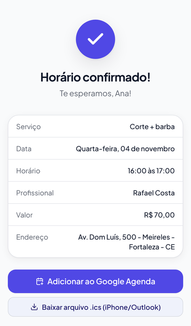
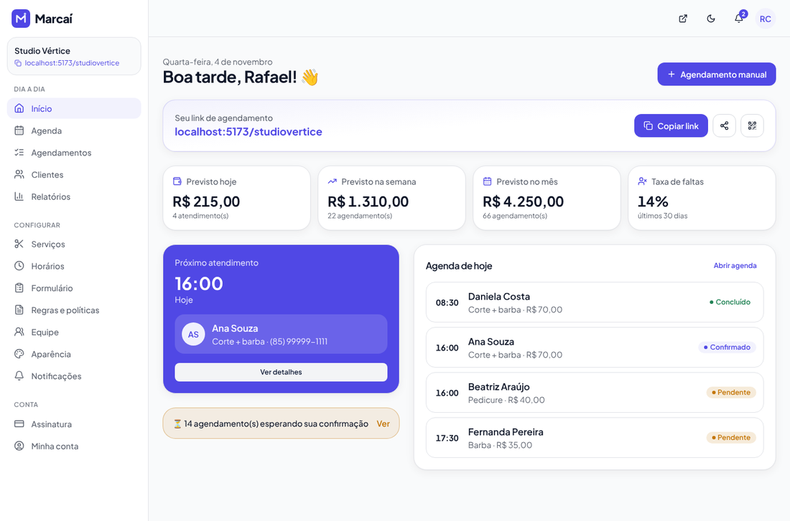
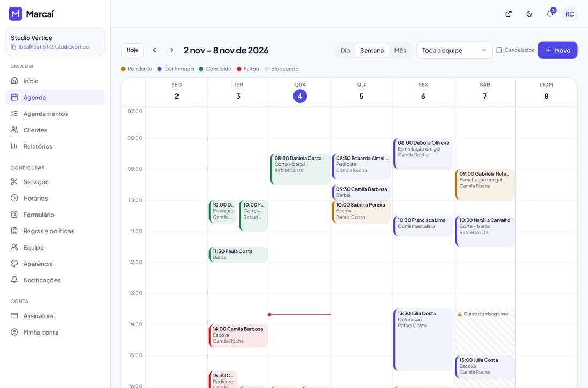
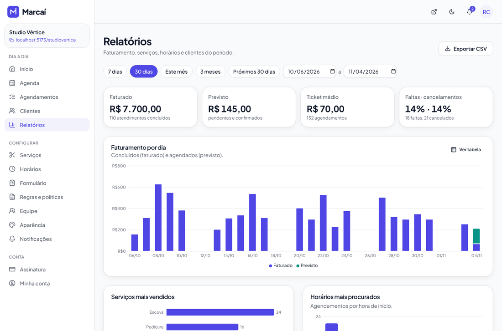
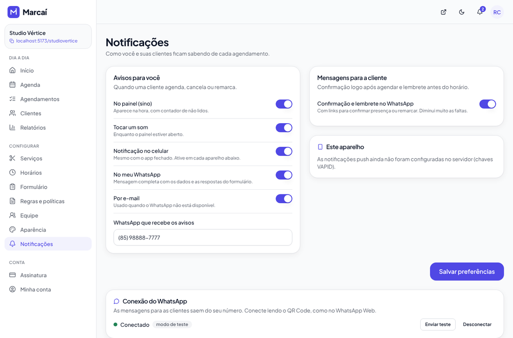
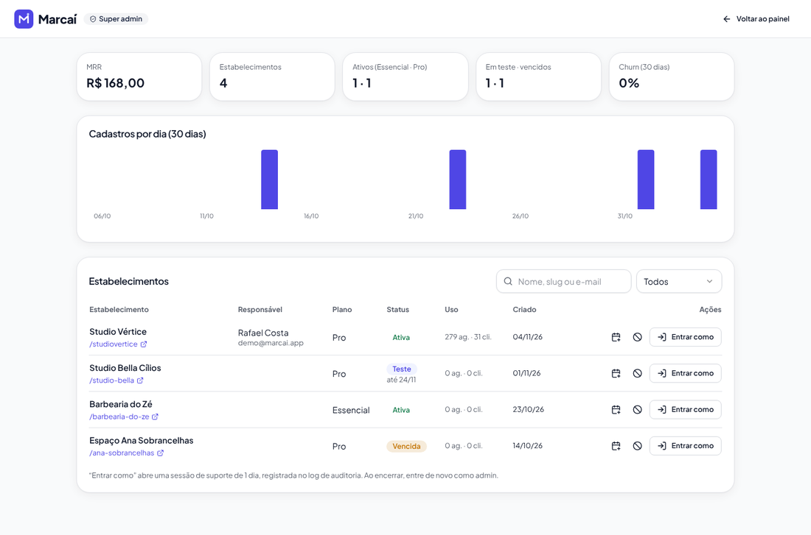

# Marcaí

> **Sua agenda cheia, sem precisar responder mensagem.**

O Marcaí é um SaaS de agendamento online para salões, barbearias, estúdios e profissionais de beleza autônomos do Brasil. A profissional coloca o link na bio do Instagram (`marcai.app/studiovertice`), a cliente escolhe o serviço, vê **só os horários livres** e confirma. O horário sai da agenda na hora, sem risco de duas clientes marcarem o mesmo horário, e a profissional recebe o aviso no painel, no celular (push) e, no plano Pro, também no WhatsApp.

O mesmo código roda em dois modos:

- **SaaS multi-tenant** (padrão): cada estabelecimento tem a página pública própria, com teste grátis de 30 dias e cobrança recorrente pelo Mercado Pago.
- **Modo exclusivo / white-label** (`APP_MODE=single_tenant`): um único estabelecimento, com a página na raiz do domínio e a marca do cliente, sem cadastro público nem cobrança.

## Prints

| Página pública (celular)                          | Escolha do horário                           | Confirmação                                 |
| ------------------------------------------------- | -------------------------------------------- | ------------------------------------------- |
|  |  |  |

| Dashboard                               | Agenda semanal                    |
| --------------------------------------- | --------------------------------- |
|  |  |

| Relatórios                                | Notificações                                  |
| ----------------------------------------- | --------------------------------------------- |
|  |  |

| Landing page                        | Super admin                           | Área da cliente                                     |
| ----------------------------------- | ------------------------------------- | --------------------------------------------------- |
|  |  |  |

## Stack

| Camada                            | Tecnologias                                                                                                                                                                                                              |
| --------------------------------- | ------------------------------------------------------------------------------------------------------------------------------------------------------------------------------------------------------------------------ |
| Monorepo                          | pnpm workspaces · TypeScript strict · ESLint + Prettier · Husky + lint-staged · GitHub Actions                                                                                                                           |
| Front (`apps/web`)                | React 19 · Vite · React Router 7 · TanStack Query · Tailwind CSS + componentes no estilo shadcn/ui (Radix) · lucide-react · React Hook Form + Zod · date-fns(-tz) · Framer Motion · Recharts · dnd-kit · vite-plugin-pwa |
| Back (`apps/api`)                 | Node.js · Fastify 5 · Prisma 6 · PostgreSQL 16 · Zod (fastify-type-provider-zod) · Swagger/OpenAPI · Resend/SMTP · Web Push (VAPID)                                                                                      |
| Compartilhado (`packages/shared`) | Schemas Zod, motor de disponibilidade, planos/feature gating, feriados, paleta de cores, templates de mensagem, presets                                                                                                  |
| Testes                            | Vitest (unitários e de integração com Postgres real) · Playwright (E2E)                                                                                                                                                  |

## Como rodar localmente

Pré-requisitos: **Node 20+**, **pnpm 10+** e **Docker** (ou um PostgreSQL 16 local).

```bash
cp apps/api/.env.example apps/api/.env
```

```bash
docker compose up -d && pnpm install && pnpm db:migrate && pnpm db:seed && pnpm dev
```

- Front: http://localhost:5173 (o Vite encaminha `/api` e `/uploads` para a API)
- API: http://localhost:3333 · documentação Swagger: http://localhost:3333/api/docs
- Página pública de exemplo: http://localhost:5173/studiovertice

**Logins do seed**

| Perfil                 | E-mail              | Senha       |
| ---------------------- | ------------------- | ----------- |
| Dona (demo)            | `demo@marcai.app`   | `demo1234`  |
| Profissional da equipe | `camila@marcai.app` | `demo1234`  |
| Super admin            | `admin@marcai.app`  | `admin1234` |

O seed cria o **Studio Vértice** (`/studiovertice`), um salão fictício de cabelo, barba e unhas, com 9 serviços, 2 profissionais (Rafael Costa e Camila Rocha), perguntas personalizadas no formulário, expediente de terça a sábado (08:00–12:00 e 13:30–19:00), 30 clientes e cerca de 270 agendamentos nas últimas 6 e nas próximas 3 semanas, com status variados, para os relatórios já aparecerem preenchidos.

Sem chaves configuradas, **tudo funciona em modo de simulação**: e-mails e mensagens de WhatsApp aparecem no log da API, e a cobrança usa o provedor _fake_, com o botão "Simular pagamento" na tela de assinatura.

### Scripts

| Comando                                        | O que faz                                                                                   |
| ---------------------------------------------- | ------------------------------------------------------------------------------------------- |
| `pnpm dev`                                     | Sobe a API (com o worker da fila embutido) e o front juntos                                 |
| `pnpm db:migrate` / `pnpm db:deploy`           | Migrations em dev / em produção                                                             |
| `pnpm db:seed`                                 | Recria os dados de demonstração                                                             |
| `pnpm lint` · `pnpm typecheck` · `pnpm test`   | Qualidade e testes (os testes da API usam o banco `marcai_test`)                            |
| `pnpm test:e2e`                                | Playwright: sobe a API e o front contra o banco `marcai_e2e`, aplica as migrations e o seed |
| `pnpm build`                                   | Build de produção (API com tsup, front com Vite)                                            |
| `pnpm --filter @marcai/api worker`             | Worker da fila em processo separado                                                         |
| `pnpm --filter @marcai/api tenant:create -- …` | Cria a dona e o estabelecimento pela linha de comando (modo exclusivo)                      |

## Variáveis de ambiente

O arquivo [`apps/api/.env.example`](apps/api/.env.example) lista e comenta todas. As principais:

| Variável                       | Para que serve                                                                            |
| ------------------------------ | ----------------------------------------------------------------------------------------- |
| `APP_MODE`                     | `saas` (padrão) ou `single_tenant`                                                        |
| `APP_URL` / `API_URL`          | URLs públicas do front e da API (links em mensagens, CORS, callbacks)                     |
| `DATABASE_URL`                 | PostgreSQL                                                                                |
| `SESSION_SECRET`               | Segredo do hash dos tokens de sessão (`openssl rand -hex 32`)                             |
| `COOKIE_SAMESITE`              | `lax` com front e API no mesmo domínio (recomendado); `none` se forem domínios diferentes |
| `GOOGLE_CLIENT_ID/SECRET`      | Login com Google (opcional)                                                               |
| `RESEND_API_KEY` / `SMTP_*`    | E-mails transacionais (Resend ou qualquer SMTP) e `EMAIL_FROM`                            |
| `VAPID_PUBLIC_KEY/PRIVATE_KEY` | Web Push (`npx web-push generate-vapid-keys`)                                             |
| `WHATSAPP_PROVIDER`            | `console`, `evolution` ou `meta`                                                          |
| `BILLING_PROVIDER`             | `fake` ou `mercadopago`                                                                   |
| `RUN_WORKER_IN_API`            | Roda o worker da fila dentro da API (prático no dev)                                      |
| `WEB_DIST_DIR`                 | Faz a API servir o build do front, com as meta tags Open Graph injetadas                  |

## Configurando integrações

### Mercado Pago (cobrança: PIX, boleto e cartão)

1. Crie uma aplicação em [Mercado Pago Developers](https://www.mercadopago.com.br/developers/panel/app) (produto **Checkout Pro** + **Assinaturas**). Para testar, use as **credenciais de teste** e contas de teste (comprador/vendedor).
2. Configure `BILLING_PROVIDER=mercadopago` e `MP_ACCESS_TOKEN` (o _Access Token_ da aplicação; `TEST-...` no teste, `APP_USR-...` em produção).
3. Em _Suas integrações → Webhooks_, cadastre a URL `{API_URL}/api/webhooks/mercadopago` com os eventos **Pagamentos**, **Planos e assinaturas** (`subscription_preapproval`) e **Pagamentos recorrentes** (`subscription_authorized_payment`). Copie a **assinatura secreta** para `MP_WEBHOOK_SECRET`.
4. Como funciona:
   - **Cartão**: a dona autoriza uma vez no Mercado Pago (assinatura automática / _preapproval_) e a mensalidade é cobrada todo mês, começando no fim do teste grátis.
   - **PIX / boleto**: o sistema gera a fatura `BILLING_INVOICE_DAYS_BEFORE` dias antes do vencimento, avisa por e-mail e o botão **Pagar** abre o Checkout Pro com o valor certo.
   - Toda notificação é conferida pela assinatura `x-signature` (HMAC-SHA256, janela de 15 min) e o pagamento é **buscado na API do Mercado Pago** pelo id: o corpo da notificação nunca é usado. Pagamento com valor menor que a fatura é ignorado.
   - Os eventos são idempotentes (`WebhookEvent`): `trial`/`past_due` → `active` quando paga; a rotina diária marca faturas vencidas e `active` → `past_due` quando o período acaba (carência de 7 dias antes do modo somente leitura).

   - **Estorno ou contestação** desconta o mês pago (volta para o teste ou para "em atraso"). Pagamento pelo link de uma fatura cancelada é aceito; um segundo pagamento da mesma fatura fica registrado na auditoria (`invoice.duplicate_payment`) para estorno.
   - Cartão recusado: a tela oferece **Cadastrar outro cartão** e **Pagar este mês por PIX** (sem desligar o cartão).
   - O registro do evento e a aplicação acontecem na mesma transação: se algo falhar, o reenvio do Mercado Pago processa de novo.

Em desenvolvimento, `BILLING_PROVIDER=fake` mostra o botão **Simular pagamento** (só com a API em localhost ou `ALLOW_FAKE_BILLING=true`, nunca em produção), que percorre o mesmo fluxo do webhook. A cobrança fica atrás da interface `BillingProvider` (`apps/api/src/modules/billing/provider.ts`).

### WhatsApp: Evolution API (número da própria profissional, via QR Code)

1. Suba a [Evolution API](https://doc.evolution-api.com) (self-hosted, Docker) e defina a `AUTHENTICATION_API_KEY` dela.
2. Configure `WHATSAPP_PROVIDER=evolution`, `EVOLUTION_API_URL`, `EVOLUTION_API_KEY` e um `EVOLUTION_WEBHOOK_SECRET` aleatório.
3. No painel, em **Notificações → Conexão do WhatsApp**, a profissional clica em _Conectar WhatsApp_ e lê o QR Code. A API cria a instância `marcai-{tenantId}` e registra o webhook `{API_URL}/api/webhooks/evolution?token=SEGREDO`, que mantém o status da conexão atualizado.
4. O botão **Enviar teste** manda uma mensagem para o número cadastrado. Se o celular desconectar, a dona recebe um aviso no painel e por e-mail para ler o QR Code de novo. Antes de desistir de um envio, a API confere o status direto na Evolution (caso um webhook tenha se perdido). Números sem WhatsApp falham de vez, sem repetir.
5. Compatível com a Evolution API **v2** (`/message/sendText` com `{ number, text }`).

### E-mail (Resend ou SMTP)

- **Resend:** configure `RESEND_API_KEY` e um `EMAIL_FROM` com domínio verificado.
- **SMTP** (Gmail com senha de app, Hostinger, Zoho, Amazon SES...): configure `SMTP_HOST`, `SMTP_PORT` (587 ou 465), `SMTP_SECURE` (`true` na 465), `SMTP_USER` e `SMTP_PASS`.
- Sem nenhum dos dois, os e-mails só aparecem no log (em produção, a API nem sobe sem um deles). A tela **Notificações** avisa quando isso acontece e tem o botão **Enviar e-mail de teste**.

O que sai por e-mail: novo agendamento, cancelamento e remarcação (para a dona e a profissional), confirmação, lembrete, cancelamento e remarcação (para a cliente que informou e-mail), resumo do dia, cobrança (fatura disponível, pagamento confirmado, cartão recusado) e aviso de WhatsApp desconectado.

### Som no painel

Com **Tocar um som** ligado, o painel toca um aviso a cada notificação nova (agendamento, cancelamento, remarcação, presença confirmada), mesmo com a aba em segundo plano, e mostra o número de avisos não lidos no título da aba. Os navegadores só liberam áudio depois do primeiro clique na página: até lá, o sino mostra um aviso para clicar. O botão **Testar som** confere se o som está funcionando.

### WhatsApp: Meta Cloud API (número oficial da plataforma)

1. No [Meta for Developers](https://developers.facebook.com), crie um app do tipo _Business_ com o produto WhatsApp e registre o número.
2. Aprove um **template** de categoria _Utility_ em pt_BR com uma única variável no corpo, por exemplo `{{1}}`. Configure `META_WA_TEMPLATE_NAME` e `META_WA_TEMPLATE_LANG`.
3. Configure `WHATSAPP_PROVIDER=meta`, `META_WA_TOKEN` (token permanente de usuário do sistema), `META_WA_PHONE_NUMBER_ID`, `META_WA_APP_SECRET` e `META_WA_VERIFY_TOKEN`.
4. Configure o webhook do app para `{API_URL}/api/webhooks/meta`. A verificação usa o `META_WA_VERIFY_TOKEN`, e cada chamada é validada pela assinatura HMAC `X-Hub-Signature-256` com o `META_WA_APP_SECRET`.

> Os parâmetros de template da Meta não aceitam quebras de linha, então o texto da mensagem é enviado em uma linha (`·` no lugar das quebras).

### Web Push e PWA

Gere as chaves com `npx web-push generate-vapid-keys` e configure `VAPID_PUBLIC_KEY`, `VAPID_PRIVATE_KEY` e `VAPID_SUBJECT`. Em **Notificações → Este aparelho**, a profissional ativa o push em cada celular. No iPhone, ela precisa antes instalar o painel pela opção "Adicionar à Tela de Início" (iOS 16.4+).

### Login com Google

Crie credenciais OAuth (_Aplicativo da Web_) no Google Cloud com o URI de redirecionamento `{API_URL}/api/auth/google/callback` e configure `GOOGLE_CLIENT_ID` e `GOOGLE_CLIENT_SECRET`. O botão aparece automaticamente.

## Modo exclusivo (white-label)

Para vender o sistema exclusivo a um cliente:

1. Crie o estabelecimento e a dona:
   ```bash
   pnpm --filter @marcai/api tenant:create -- --nome "Studio Bella Cílios" --slug studiobella --email dona@studiobella.com.br --senha "TroqueEssaSenha1" --tipo cilios --cor "#7C3AED"
   ```
2. Configure `APP_MODE=single_tenant`, `SINGLE_TENANT_SLUG=studiobella`, `APP_NAME="Studio Bella"` e o `EMAIL_FROM` com o domínio do cliente.
3. Pronto:
   - a página de agendamento abre na **raiz** do domínio (`/`), sem slug;
   - nome, logo, cor, favicon e textos vêm do cadastro do estabelecimento (_Aparência_);
   - não aparece o cadastro público, a cobrança nem a landing, e nenhuma menção ao Marcaí fica visível para a cliente final;
   - todos os recursos do plano Pro ficam liberados.

## Deploy

**Recomendado:** front na Vercel (ou Netlify), API + worker no Railway (ou Render) e banco no Neon (ou Supabase).

1. **Banco:** crie um Postgres 16 no Neon/Supabase e use a connection string em `DATABASE_URL`. A extensão `btree_gist`, que a proteção contra horários duplicados usa, é criada pela própria migration.
2. **API (Railway/Render):** use o [`apps/api/Dockerfile`](apps/api/Dockerfile) com o contexto de build na **raiz** do repositório:
   ```bash
   docker build -f apps/api/Dockerfile -t marcai-api .
   ```
   O container aplica as migrations (`prisma migrate deploy`) e sobe a API. Configure as variáveis de `apps/api/.env.example` com `NODE_ENV=production` e `RUN_WORKER_IN_API=false`.
3. **Worker:** crie um segundo serviço com a **mesma imagem** e o comando `node dist/worker.js`. Ele processa a fila de notificações, os lembretes, o resumo diário e a rotina de cobrança. Dá para rodar mais de uma réplica, porque a fila usa `FOR UPDATE SKIP LOCKED`.
4. **Front (Vercel):** importe o repositório com _Root Directory_ = `apps/web`. O arquivo [`apps/web/vercel.json`](apps/web/vercel.json) já faz:
   - o rewrite de `/api`, `/uploads`, `/sitemap.xml` e `/robots.txt` para a API. Assim os cookies de sessão ficam no **mesmo domínio**, então use `COOKIE_SAMESITE=lax`;
   - o rewrite dos robôs do WhatsApp/Instagram/Facebook para `/api/public/og`, que devolve o HTML com as meta tags Open Graph de `/` e `/:slug` e gera a prévia bonita ao compartilhar o link.

   Troque `SUA-API.up.railway.app` pelo domínio da API. Para a Netlify, o equivalente está em [`apps/web/netlify.toml`](apps/web/netlify.toml).

5. **Alternativa em um único serviço:** a mesma imagem Docker já embute o build do front (`WEB_DIST_DIR=/app/web`), e a API serve o SPA injetando as meta tags. É só apontar o domínio para ela.
6. **Uploads:** o armazenamento padrão é local (`UPLOAD_DIR`). Em produção, monte um volume persistente ou implemente a interface `StorageProvider` (`apps/api/src/lib/storage.ts`) com S3/R2.

## Documentação

- [`docs/ARQUITETURA.md`](docs/ARQUITETURA.md): módulos, fluxo de agendamento, fluxo de notificação, multi-tenancy e decisões tomadas.
- Swagger/OpenAPI em `/api/docs`.

## Checklist

### Implementado

- [x] Monorepo pnpm (web, api e shared), TypeScript strict, ESLint, Prettier, Husky e CI no GitHub Actions (lint, typecheck, testes, build e E2E)
- [x] Autenticação com sessão em cookie httpOnly, CSRF (double submit), bcrypt, login com Google, recuperação e troca de senha
- [x] Multi-tenancy com `tenantId` injetado na camada de dados (`forTenant`) e testes de isolamento
- [x] Onboarding em 4 passos, com slug verificado em tempo real, presets por tipo de negócio, link pronto e QR Code
- [x] Serviços e categorias (CRUD, ordenação por arrastar, foto, "a partir de", intervalo pós-atendimento, soft delete)
- [x] Expediente com vários turnos, folgas, pausas fixas, feriados nacionais automáticos, antecedência mínima/máxima e intervalo entre opções
- [x] Construtor de campos personalizados (6 tipos, por serviço) com preset de manicure
- [x] Motor de disponibilidade testado (turnos, bloqueios, duração + limpeza, antecedência, virada de dia, fusos)
- [x] Página pública mobile-first, com Google Agenda, `.ics`, link de gestão, honeypot, rate limit por IP e por telefone e consentimento LGPD
- [x] Reserva à prova de concorrência (exclusion constraint `tsrange` + `btree_gist`) com teste de requisições simultâneas
- [x] Painel: dashboard, agenda dia/semana/mês com arrastar e soltar, agendamento manual, bloqueio pela agenda, lista com filtros e ações, clientes com histórico, tags e importação/exportação CSV
- [x] Equipe com permissões de dona e profissional (a profissional vê só a própria agenda)
- [x] Notificações in-app (SSE + polling), Web Push, e-mail e WhatsApp (Evolution, Meta e console), com fila, retry, backoff, som no painel, alerta de WhatsApp desconectado e e-mail por Resend ou SMTP
- [x] Mensagens editáveis com variáveis e pré-visualização; lembrete configurável; resumo diário às 07:00
- [x] Área da cliente por token: ver, confirmar presença, remarcar e cancelar, respeitando a política
- [x] Planos Essencial/Pro, teste de 30 dias, Mercado Pago (PIX, boleto, cartão), webhooks idempotentes e com verificação, carência de 7 dias e modo somente leitura
- [x] Feature gating centralizado (`packages/shared/src/plans.ts`) com aviso de upgrade
- [x] Modo exclusivo (white-label)
- [x] Relatórios com gráficos e exportação CSV
- [x] Super admin: MRR, cadastros, churn, estender teste, bloquear e "entrar como" auditado
- [x] Landing page, termos de uso, política de privacidade (LGPD), SEO, Open Graph no servidor, sitemap e robots
- [x] Aparência com paleta gerada (contraste AA) e pré-visualização ao vivo; modo escuro no painel; PWA instalável
- [x] LGPD: consentimento, exportação e exclusão de dados da cliente e da profissional
- [x] Seed de demonstração, testes (shared, integração da API e E2E), Dockerfile, README e arquitetura

### Para versões futuras

- [ ] Armazenamento de uploads em S3/R2 e redimensionamento de imagens
- [ ] Rate limit e SSE distribuídos com Redis (hoje são em memória por instância; o polling de 15s cobre o caso de várias instâncias)
- [ ] Sinal (pagamento antecipado por PIX) no agendamento para reduzir faltas
- [ ] Lista de espera para horários lotados e aviso quando abrir vaga
- [ ] Pacotes, combos e programa de fidelidade
- [ ] Sincronização bidirecional com o Google Agenda
- [ ] Domínio próprio por estabelecimento no modo SaaS
- [ ] Notas fiscais (NFS-e) da assinatura
- [ ] Internacionalização (es/en) e outras moedas
- [ ] App nativo (React Native) com o mesmo `packages/shared`
